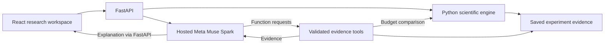

# Q-Bridge

**Adaptive Bayesian calibration and guarded quantum circuit placement, explained with Meta Muse Spark.**

Built for the **[Meta Global AI Developer Hackathon — Indie Developer Track](https://cerebralvalley.ai/e/meta-ai-developer-hackathon)**.

Q-Bridge helps researchers answer two connected questions: **What should we measure with a limited calibration budget? And does the resulting evidence justify changing a circuit’s placement across quantum processors?**

The Python engine directs calibration toward measurements with the highest expected placement benefit. The dashboard makes its decisions and uncertainty inspectable. Meta’s hosted Muse Spark model turns recorded evidence into research explanations through genuine function calling.

**This is a working simulation research prototype. No physical quantum processor is connected.** The scientific engine, FastAPI backend, React dashboard and hosted-model assistant are implemented. A live Muse Spark evidence-retrieval and completed explanation flow was verified on 5 November 2026. Live model-driven budget comparison remains unverified, although its Python tool and local tests are implemented.

[Run locally](#run-locally) · [Demo script](docs/DEMO_SCRIPT.md) · [Scientific method](docs/SCIENTIFIC_INTERFACE.md) · [Research evidence](research/README.md) · [Meta integration](docs/ASSISTANT_WALKTHROUGH.md)

## Research origin and hackathon contribution

Before the hackathon, my [NS-QPEFT research](https://github.com/harsh-21-chauhan/NS-QPEFT) explored predicting simulated quantum-circuit behavior from circuit features and local/link noise. That work motivated a different question: **when the noise rates are uncertain, which limited measurements are worth making before choosing a circuit placement?**

During this hackathon, I developed Q-Bridge's Bayesian calibration and placement workflow, evaluated alternative policies, and built the FastAPI/React workspace and Meta Muse Spark assistant. Q-Bridge is a separate implementation. It does not use NS-QPEFT's trained network or extend its neural architecture. The earlier project is research background, not a new hackathon feature or a claimed peer-reviewed publication.

Early Q-Bridge experiments showed that learning about one error source while another remains misestimated can trigger harmful placement changes. That finding motivated exploratory measurements across the groups, sequential EVSI allocation and an optional switching guard. The final policy is an experimentally motivated compromise, not a universally optimal solution.

## What you can do

- **Run an experiment:** select a circuit, qubit count, calibration budget and reproducible simulated scenario.
- **Follow adaptive calibration:** inspect exploratory measurements, subsequent EVSI choices and every Bayesian update.
- **Understand placement:** compare initial, candidate and final assignments across two processors, with local and remote gate counts.
- **Inspect uncertainty:** view posterior means, 95% credible intervals and the evidence for accepting or retaining a placement.
- **Compare and reproduce:** explore budget alternatives, reopen saved records, export JSON and inspect eight benchmark policies.
- **Ask Muse Spark:** obtain an evidence-grounded explanation with structured Decision, Evidence and Uncertainty sections and inspect the underlying Python tool results.

## Why Meta’s model matters

Researchers need to understand why a placement was retained, what informed calibration choices and what uncertainty remains. Muse Spark supplies an interactive natural-language layer over the scientific results.

The assistant uses Meta’s hosted Model API with `muse-spark-1.3`. It requests scoped backend functions:

| Tool | Purpose |
|---|---|
| `get_experiment_evidence` | Retrieve the selected experiment’s measurements, posterior uncertainty, placement and decision evidence. |
| `compare_budget` | Run a user-selected budget alternative using the saved seed and scenario, then return both records with interpretation limits. |

FastAPI validates the tool requests, executes the Python functions and returns their results to Muse Spark for a final explanation. **The language model does not perform Bayesian calculations or select the scientific placement.** Numerical evidence cards are rendered from backend data, separately from model prose. Simulator-only truth is excluded from these tools.

The key stays in the backend environment. Development defaults to mock mode. Live access requires explicit configuration and deliberate submission. Persistent application reservations, request and output limits, no automatic retries, and a pause/resume control reduce spending risk. These controls are **not a guarantee of zero card charges** and do not query the provider’s credit balance. See the [assistant guide](docs/ASSISTANT_WALKTHROUGH.md).

## How it works



1. Start with illustrative Beta priors for local operations on A and B, and remote operations.
2. Spend an initial exploration budget across all three groups.
3. Use **expected value of sample information (EVSI)** to select further calibration batches by expected decision benefit, updating beliefs after each batch.
4. Find the balanced placement with the lowest posterior expected task loss.
5. With the default guard enabled, accept a change only when expected improvement is positive and sampled posterior support reaches 60%.

The selected policy is `adaptive_original_guard60`. At a 100-shot budget, the pilot uses 10 shots on A, 10 on B and 20 on the link, followed by two adaptive 30-shot batches. The [scientific contract](docs/SCIENTIFIC_INTERFACE.md) and [final method decision](docs/QBridge-M2C-final-decision.md) explain the calculations and trade-offs.

## Run locally

Use Python 3.10+ and Node.js 22.12+ with a compatible major version supported by Vite 7. Python 3.11 and macOS were used for verification. The assistant’s process lock uses `fcntl`, so its current backend requires macOS/Linux (or WSL). Bind this unauthenticated local prototype to `127.0.0.1`.

From a fresh checkout:

```bash
git clone https://github.com/harsh-21-chauhan/Q-Bridge.git
cd Q-Bridge
python3 -m venv .venv
source .venv/bin/activate
python -m pip install -e '.[api,dev,api-test]'
python -m backend.run
```

If you already use Conda, activate `qbridge` instead of creating `.venv`. The command above starts the backend in mock mode without contacting Meta. The scientific dashboard needs no API key.

In a second terminal, from the repository root:

```bash
cd frontend
npm ci
npm run dev
```

Open [the dashboard](http://127.0.0.1:5173) and [interactive API documentation](http://127.0.0.1:8000/docs). Keep both terminals running. On later starts, skip installation and use `python -m backend.run` and `npm run dev` in their respective directories.

For an authorized live Muse Spark session, stop the existing backend first and run:

```bash
python -m backend.run --live
```

The launcher privately prompts for the Meta API key if `MODEL_API_KEY` is absent. It does not save the key to disk or make a model call at startup. A Meta account with working model access and billing verification is required. Do not place keys in React, tracked files, recordings or chat. [Detailed setup and troubleshooting](docs/SETUP.md).

## Suggested demo

Use **Layered Clifford · 6 qubits · 100 shots · Local + link shift · seed 42 · placement guard enabled**. Click **Run calibration**, inspect the circuit, select an adaptive stage, then review the posterior and placement.

In the verified run, all 100 shots were used and the initial placement was retained. The final expected task loss was `0.075165` and accepted improvement was zero. Retention is a valid result, not a failed run. No switch probability was estimated because the candidate was already the incumbent.

Finish in **Research assistant**, leave the budget selector on **Explain this experiment**, and ask **“Why was this placement selected?”** Show the returned explanation and its technical tool record. The [three-minute script and component guide](docs/DEMO_SCRIPT.md) provide exact actions and interpretation notes. The video recording is being prepared separately. It opens with the earlier NS-QPEFT research attribution, then shows the Q-Bridge workflow and where Muse Spark is used, without slides.

## Research evidence and validation

The frozen benchmark contains **40 configurations × 100 trials × 8 policies = 32,000 policy outcomes**. These are 4,000 trial/configuration pairs, not 32,000 independent experiments. Quick runs overlap the full evidence and are excluded from dashboard aggregates.

The selected 60% guard has observed overall mean regret of approximately **0.001299**, with a **4.45%** harmful-switch rate across all trials. It had the lowest observed overall mean regret among the eight policies. Its small advantage over unguarded adaptive EVSI is **not established as universal**. Scenario intervals do not supply a combined confidence interval. See the [full summary](research/summaries/m2c-final-summary.csv) and [decision report](docs/QBridge-M2C-final-decision.md).

Local verification on 5 November 2026: **204 Python tests and 24 frontend tests passed**, and the production frontend build passed. The Python run reported one Starlette/HTTPX deprecation warning. Desktop and narrow-screen layouts were reviewed. The live evidence-retrieval explanation was verified separately, not by the offline suite.

Run checks from the repository root:

```bash
python -m pytest -q
python scripts/verify_research_evidence.py
cd frontend
npm test
npm run build
```

Optional independent Qiskit Aer checks require `python -m pip install -e '.[aer]'`. Without Aer, its two optional tests are skipped. Scientific regression tests cover budget accounting, Bayesian updates, archived-policy equivalence, reproducibility and separation of simulator truth from decisions. Assistant tests cover tool validation, limits, failures, pause/resume and mock/live labeling without paid requests.

For a command-line scientific experiment:

```bash
python -m qbridge.production --family layered --qubits 6 --shots 100 --seed 42
```

## Scientific scope

- Two labeled processors with balanced qubit allocation. Exact enumeration supports 6 or 12 qubits, with 20 or 924 candidate placements.
- Small GHZ, layered and star Clifford circuits with three independent, static effective Pauli-error groups.
- **Task loss is mean stabilizer-generator parity error, not quantum state fidelity.**
- Remote operations use a simplified channel. There is no physical teleportation, Bell-pair generation or network-timing model.
- Diagnostics are idealized. Readout noise, coherent errors, drift and correlations are not modeled.
- Hidden simulator truth generates observations and grades completed decisions. It is not available to the calibration planner or assistant evidence tools.
- A guard can reject helpful changes and can still be wrong when the prior or model is wrong. More measurements do not guarantee a better outcome in an individual trial.

## Repository and documentation

```text
backend/           FastAPI routes, services and local launcher
frontend/          React dashboard and presentation tests
src/qbridge/       Scientific engine and historical policy implementations
tests/             Scientific, API and assistant validation
scripts/           Research runners, summaries and integrity checks
research/          Canonical archives, summaries, examples and provenance
results/           Ignored generated runs and local usage ledger
docs/              Setup, scientific explanation, demo and research history
```

Canonical research is preserved without duplicate raw records. The [research index](research/README.md) links archives and provenance. The [repository audit](docs/REPOSITORY_AUDIT.md) records cleanup history.

- [Demo script and plain-language component guide](docs/DEMO_SCRIPT.md)
- [Setup](docs/SETUP.md), [backend walkthrough](docs/BACKEND_WALKTHROUGH.md), [dashboard walkthrough](docs/FRONTEND_WALKTHROUGH.md)
- [Muse Spark integration and verification](docs/ASSISTANT_WALKTHROUGH.md)
- [Scientific interface](docs/SCIENTIFIC_INTERFACE.md), [specification](docs/SPEC.md), [final method decision](docs/QBridge-M2C-final-decision.md)
- Historical research: [M1](docs/M1_WALKTHROUGH.md), [M2 diagnostics](docs/M2_DIAGNOSTICS.md), [M2B](docs/M2B_GUIDE.md), [M2C](docs/M2C_GUIDE.md)

Historical guides retain their milestone-specific defaults. They are research records, not the current application startup instructions.
