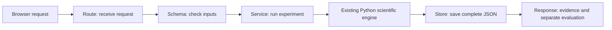

# Understand the backend and explain it in your demo

The backend is the part of Q-Bridge that receives a request, runs the scientific calculation, saves the result and sends it back. React will become the visible dashboard later. For now, FastAPI's `/docs` page lets you perform the same requests by hand.

## The complete journey in seven steps

1. **You choose an experiment.** For example: layered circuit, six qubits, 100 shots and seed 42. The seed makes the simulated run reproducible. `truth_mode` chooses a synthetic environment; it is not measured hardware data.
2. **FastAPI receives the request.** A route is just an address associated with a Python function. `POST /api/experiments` means “create an experiment.” The body is a JSON object containing your choices.
3. **Pydantic checks the choices.** It rejects unsupported circuits, invalid budgets and incorrect types. For example, `shots: "100"` is a string, while `shots: 100` is an integer. This prevents ambiguous requests from reaching the scientific code.
4. **The service calls our existing scientific function.** It converts the request into `SimulationConfig`, then calls `qbridge.production.run_experiment`. The API layer does not invent a different calibration algorithm.
5. **The Python engine performs adaptive calibration.** It starts with original Beta priors, measures all three groups, updates posteriors, chooses later batches with EVSI and evaluates placements. The optional guard checks whether there is enough posterior support for a switch. The decision engine sees measurement outcomes, not hidden true error rates.
6. **The store saves a JSON record.** An experiment gets a deterministic ID. The store writes a complete temporary file before publishing it, so an interrupted write cannot expose half a record. Repeating the same configuration reuses the identical saved record.
7. **The response returns to the browser.** It includes the five calibration steps, estimated noise, three placements and guard explanation. Hidden truth and oracle grading remain in the separately labeled `evaluation` section.

## Where to look in the code

Read these files in this order. Comments explain why the boundaries exist; straightforward operations are kept small.

| File | Plain-language responsibility |
|---|---|
| [`backend/app/main.py`](../backend/app/main.py) | Assemble the server, connect routes/services, and return readable errors. |
| [`backend/app/routes/experiments.py`](../backend/app/routes/experiments.py) | Receive experiment requests and choose which service function to call. |
| [`backend/app/schemas.py`](../backend/app/schemas.py) | Define acceptable input and the shape of the returned scientific data. Most of this file lists fields; it is not a new algorithm. |
| [`backend/app/services/experiment_service.py`](../backend/app/services/experiment_service.py) | Call the scientific engine, save its output, and construct an evidence-only response. |
| [`src/qbridge/production.py`](../src/qbridge/production.py) | Run the finalized scientific workflow using the earlier validated modules. |
| [`backend/app/services/experiment_store.py`](../backend/app/services/experiment_store.py) | Read/write one JSON file per experiment; reject bad IDs, damaged records and conflicting overwrites. |
| [`backend/app/services/report_service.py`](../backend/app/services/report_service.py) | Read the already completed M2C summary, check its checksum and prepare chart-friendly statistics. |
| [`backend/app/config.py`](../backend/app/config.py) | Choose the experiment-storage and research-evidence directories. |

There is no database server, message queue, login system, external model client or hidden background calibration job. One worker allows one active calculation at a time, which keeps the local workflow predictable. Ordinary synchronous route functions let FastAPI move the work off its async event loop; see the [FastAPI explanation](https://fastapi.tiangolo.com/async/).

## Explain the science without memorizing every formula

**Placement:** decide which logical qubits live on QPU A and which live on QPU B. An interaction between processors uses the remote error group. Each processor holds half the qubits.

**Shot:** one simulated diagnostic observation—success or failure—about one error group. The 100-shot budget is shared across A, B and the remote link; it is not 100 shots for each group.

**Prior:** the uncertainty model before this experiment. The starting 2%, 3% and 5% values are illustrative prior means, not real hardware measurements.

**Posterior:** the updated uncertainty model after observing failures and successes. A Beta update adds failures to alpha and successes to beta. Python performs this calculation.

**EVSI:** the expected benefit of measuring a particular group for the later placement decision. It helps choose the most decision-useful next experiment, rather than simply measuring the group with the highest error estimate.

**Guard:** after finding the candidate placement, compare it with the initial placement under posterior samples. The default requires positive expected improvement and at least 60% sampled probability of benefit. This threshold is a risk preference under the model, not a guarantee.

**Task loss:** the modeled average probability of an incorrect stabilizer parity outcome. Say “task loss,” not “full quantum state fidelity.” Lower is better.

**Oracle/regret:** after the decision, the simulator can reveal its hidden truth and find the best placement under that truth. Regret is the loss gap from that oracle. The algorithm does not get to see the answer beforehand.

## Read the response accurately

| Response section | What to say |
|---|---|
| `result.calibration.trace` | “These are the five measurement stages and the Bayesian updates they caused.” |
| `result.final_posterior` | “These are the learned error estimates and their uncertainty under our model.” |
| `result.placements.initial` | “This is the best placement before taking the new measurements.” |
| `result.placements.candidate` | “This is the best placement according to the updated expected loss.” |
| `result.placements.final` | “This is the decision after applying the selected guard mode.” |
| `result.decision` | “This explains whether we switched and what probability evidence was actually computed.” |
| `result.loss` | “We compare both placements under the same final posterior.” |
| `evaluation` | “These are simulator-only scores, calculated after making the decision.” |

If the candidate equals the initial placement, the probability is `null`. Explain it as **“no switch probability was needed”**, not “zero confidence” or “50% confidence.” If the guard rejects a candidate, candidate expected improvement can be positive while accepted improvement is zero. If new data suggests noisier hardware, an updated loss estimate can increase even though the calibration calculation is correct.

The default seed-42 example retains the original placement. That is a valid result: Q-Bridge is not designed to switch merely to look impressive. Other inputs can produce accepted or rejected switches. Do not describe one selected demo as universal performance.

## A short backend demonstration you can practice now

1. Open `/docs`, create a six-qubit, 100-shot experiment, and point out the simulation label.
2. Explain the 10/10/20 pilot and the two 30-shot adaptive batches. Show the returned trace to see which group actually received each later batch.
3. Compare the initial, candidate and final placements. Read the reason returned by the guard.
4. Copy the experiment ID into the retrieval endpoint. Explain that the run is saved and reproducible.
5. Open the benchmark summary. Explain that its charts will use existing validated results, not thousands of new simulations on each page load.

The final three-minute product video comes after React and the authorized real Meta integration. For now, don't claim the dashboard or assistant is built.

## How we know this layer works

The existing scientific tests remain. Backend tests compare the actual HTTP result with `run_experiment`, read saved runs through a new server instance, check invalid inputs and damaged records, and exercise simultaneous identical saves. Benchmark tests compare aggregate values against all 32,000 archived policy rows. The evidence-only endpoint is tested to exclude simulator truth and evaluation. These checks establish software consistency inside the simulation, not physical quantum-hardware accuracy.

For commands, endpoint addresses and troubleshooting, use [SETUP.md](SETUP.md). For detailed scientific fields, use [SCIENTIFIC_INTERFACE.md](SCIENTIFIC_INTERFACE.md).
